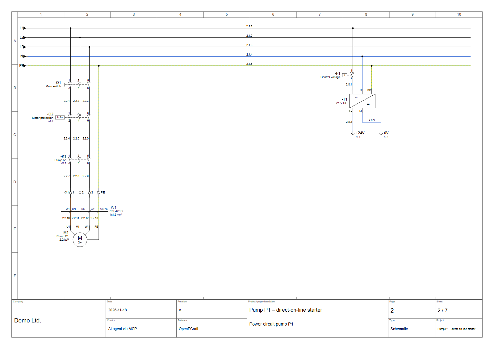

# Let an AI agent draw your schematic

OpenECraft has an MCP server. With it, an AI agent such as Claude Code, Claude Desktop,
Cursor or VS Code Copilot can create a project, place symbols, draw wires between
connection points, assign parts, run the check, and output reports and PDF / SVG /
DXF. It works on the same project files as the editor, so you can open the result,
check it and change it by hand.



The picture above is page 2 of [`demo/`](demo). Over **135 MCP tool calls** an agent
built a direct-on-line starter for a 2.2 kW pump:

- **Power circuit:** main switch `-Q1`, motor protection switch `-Q2`, contactor `-K1`,
  terminal strip `-X1`, motor cable `-W1` (4G1.5) and motor `-M1`.
- **24 V DC supply:** breaker `-F1` and power supply `-T1`.
- **Control circuit** ([page 3](demo/control.png)): stop / start push buttons in the
  door, wired through `-X2`, a self-holding contact and a "pump running" lamp.
- **Parts and pages:** parts from the built-in catalog, then a terminal diagram, cable
  overview, device list and bill of materials.

The project check ends with **0 errors and 0 warnings**. The outputs are all in `demo/`:

- the project archive [`pump_dol.oecz`](demo/pump_dol.oecz)
- the 7-page [`pump_dol.pdf`](demo/pump_dol.pdf)
- [`bill_of_materials.csv`](demo/bill_of_materials.csv)
- every call with its answer: [`transcript.md`](demo/transcript.md) (readable) and
  `transcript.jsonl` (raw JSON-RPC)

## Run the demo yourself

[`mcp_demo.py`](mcp_demo.py) is a small MCP client written in Python, using the
standard library only. It starts `openecraft-cli mcp`, does the MCP handshake, lists the
tools and replays the calls an agent makes for this circuit. It is not a language model:
it shows exactly what goes over the wire, and anyone can reproduce it without an API key.

```bash
cargo build --release -p openecraft-cli          # or use an installed openecraft-cli (--exe)
python docs/launch/ai/mcp_demo.py                # writes docs/launch/ai/demo/
python docs/launch/ai/mcp_demo.py --png          # also PNG pictures (headless Chrome or Edge)
python docs/launch/ai/mcp_demo.py --exe "C:\Users\me\AppData\Local\Programs\OpenECraft\openecraft-cli.exe" --out %TEMP%\demo
```

The script exits with 1 if a tool call fails or the check reports an error.

## Install the MCP server

The MCP server is the command line program `openecraft-cli`, started as
`openecraft-cli mcp`. It talks JSON-RPC on stdin / stdout and needs no network or
account. It comes with every package of the
[release](https://github.com/nilres/OpenECraft/releases/latest):

| System | Package | Command of the MCP server |
| --- | --- | --- |
| Windows | `OpenECraft-<version>-setup.exe`: pick the installation type **Full**, or tick *Command line and MCP server for AI agents* (the default type *Editor* leaves it out); optional: *Add OpenECraft to the PATH* | `%LOCALAPPDATA%\Programs\OpenECraft\openecraft-cli.exe mcp` (for you only, the default) or `C:\Program Files\OpenECraft\openecraft-cli.exe mcp` (all users) |
| macOS | `OpenECraft-<version>-macos.dmg`, drag *OpenECraft* to *Applications* | `/Applications/OpenECraft.app/Contents/MacOS/openecraft-cli mcp` |
| Debian, Ubuntu / Fedora | `.deb` / `.rpm` | `/usr/bin/openecraft-cli mcp` |
| Linux, tar.gz | `./install.sh` | `~/.local/bin/openecraft-cli mcp` |
| Linux, AppImage | `chmod +x` | `/path/to/OpenECraft-<version>-x86_64.AppImage cli mcp` |
| Linux, Flatpak | `flatpak install --user OpenECraft-*.flatpak` | `flatpak run --command=openecraft-cli io.github.nilres.OpenECraft mcp` |
| Linux, snap | `sudo snap install --dangerous openecraft_*.snap` | `/snap/bin/openecraft.cli mcp` |
| From source | `cargo install --path cli` (in a clone) | `~/.cargo/bin/openecraft-cli mcp` |

Check the installation with `openecraft-cli --version`. On macOS, the first start of an
unsigned build needs *System Settings › Privacy & Security › Open Anyway*.

### Where the agent may read and write files

The server confines every file a tool reads or writes to one folder. That folder is
`OPENECRAFT_MCP_ROOT`, by default the working folder of the server process, and `*`
allows every folder. **Relative paths are resolved against the working folder, not
against `OPENECRAFT_MCP_ROOT`.**

- Claude Code starts the server in your project folder, so relative paths just work.
- Claude Desktop and some other clients start it in a folder you do not choose. With
  those, set `OPENECRAFT_MCP_ROOT` to your projects folder and name that folder in your
  prompt, so the agent uses absolute paths. A call outside the folder is refused with a
  message that names the allowed folder, and agents usually retry with a correct path.

### Fewer tools for clients with a limit

The server offers over 400 tools, and their descriptions take about 270 kB (roughly
70 000 tokens). Recent versions of Claude Code load tool schemas on demand when there
are many, so all of them are fine there. Clients that put every tool into the context,
or that cap the number of tools, work
better with a subset. Cursor and VS Code are among them; VS Code allows 128 tools per
request.

The demo above runs unchanged with these 41 tools, about 25 kB:

```text
OPENECRAFT_MCP_TOOLS=new_project,open_project,save_project,convert_project,list_examples,project_info,set_project_info,undo,redo,list_pages,get_page,add_page,set_page,renumber_pages,list_symbols,place_symbol,place_part,update_symbol,move_items,delete_items,add_wire,connect,route,update_wire,add_text,list_potentials,set_wire_colors,set_wire_numbering,renumber_wires,list_devices,assign_part,list_cable_parts,add_cable_definition,apply_cable_part,table_get,table_set,check,list_reports,report,list_exports,export
```

You can add a whole group with a prefix: `parts_*` for the parts server, `panel*` and
`place_panel_device` for the panel layout, and so on. `openecraft-cli help` lists every
tool.

## Claude Code

```bash
# in the folder of your projects; the paths above for an installed openecraft-cli
claude mcp add openecraft -- openecraft-cli mcp
# for all your folders, with a fixed project folder:
claude mcp add --scope user -e OPENECRAFT_MCP_ROOT=/home/me/projects openecraft -- openecraft-cli mcp
```

To share the server with your team, put it in `.mcp.json` in the repository:

```json
{ "mcpServers": { "openecraft": { "type": "stdio", "command": "openecraft-cli", "args": ["mcp"] } } }
```

`claude mcp list` shows whether it connected. In a session, `/mcp` shows its tools.

## Claude Desktop

Open *Settings › Developer › Edit Config* and add the server to
`claude_desktop_config.json`. The file is in one of these places:

- Windows: `%APPDATA%\Claude\claude_desktop_config.json`
- macOS: `~/Library/Application Support/Claude/claude_desktop_config.json`
- Linux: `~/.config/Claude/claude_desktop_config.json`

Windows:

```json
{
  "mcpServers": {
    "openecraft": {
      "command": "C:\\Users\\me\\AppData\\Local\\Programs\\OpenECraft\\openecraft-cli.exe",
      "args": ["mcp"],
      "env": { "OPENECRAFT_MCP_ROOT": "C:\\Users\\me\\Documents\\OpenECraft" }
    }
  }
}
```

macOS:

```json
{
  "mcpServers": {
    "openecraft": {
      "command": "/Applications/OpenECraft.app/Contents/MacOS/openecraft-cli",
      "args": ["mcp"],
      "env": { "OPENECRAFT_MCP_ROOT": "/Users/me/Documents/OpenECraft" }
    }
  }
}
```

Create the folder first. Restart Claude Desktop afterwards: the tools appear under the
tools button of the chat box. In your prompts, name the folder, for example
"…save it as C:\Users\me\Documents\OpenECraft\pump.oec".

## Cursor, VS Code and other MCP clients

Every client that starts stdio servers takes the same three things: a command, the
argument `mcp`, and optionally the environment variables.

- **Cursor:** `~/.cursor/mcp.json` (all projects) or `.cursor/mcp.json` (one project):

  ```json
  { "mcpServers": { "openecraft": { "type": "stdio", "command": "openecraft-cli", "args": ["mcp"],
      "env": { "OPENECRAFT_MCP_TOOLS": "new_project,open_project,save_project,…" } } } }
  ```

- **VS Code** (Copilot agent mode): `.vscode/mcp.json` in the workspace, or *MCP: Open
  User Configuration*. Note the key `servers` and the optional `cwd`:

  ```json
  { "servers": { "openecraft": { "type": "stdio", "command": "openecraft-cli", "args": ["mcp"],
      "cwd": "${workspaceFolder}", "env": { "OPENECRAFT_MCP_TOOLS": "new_project,open_project,…" } } } }
  ```

  Alternatively, from a terminal: `code --add-mcp '{"name":"openecraft","command":"openecraft-cli","args":["mcp"]}'`.

- **Others** (Windsurf, Zed, Cline, Continue, LM Studio, Goose, …): use the
  `mcpServers` block of Claude Desktop, with the full path of `openecraft-cli` if it is
  not on the `PATH`.

## Example prompts

These prompts fit the tools of the server. The demo script replays the calls for prompt
1; how many rounds a model needs for it, and how tidy its layout is, depends on the
model. Most agents first call `list_symbols` and `get_page` to find connection points
and free space. The answers are JSON with positions in mm, so they need a few rounds;
plan on a few minutes for a whole circuit. Without a parts server the agent cannot look
up part numbers, so the first prompt names them.

1. **The demo circuit in one prompt:**

   > Create an OpenECraft project `pump_dol.oec` from the template "Empty (IEC 60204-1)",
   > with a cover sheet as page 1. Draw a direct-on-line starter for a 2.2 kW pump. Page 2,
   > power circuit: L1 L2 L3 N PE rails, main switch -Q1, motor protection switch -Q2,
   > contactor -K1, terminals -X1, motor -M1, a 4G1.5 motor cable -W1 of 15 m; a 24 V DC
   > supply -F1 / -T1 with interruption points +24V and 0V. Page 3, control circuit: NC
   > auxiliary contact of -Q2, stop -S1, start -S2 with a self-holding contact of -K1, coil
   > -K1 and a "pump running" lamp -P1; the push buttons and the lamp are in the door, wired
   > through terminal strip -X2. Parts: -Q1 GEN.MS-3P-40A, -Q2 GEN.MPS-4-6.3A +
   > GEN.MPS-AUX-1NO1NC, -K1 GEN.CT-9A-24DC + GEN.AUX-2NO2NC, -M1 GEN.MOT-2.2KW, -X1
   > GEN.TB-2.5 + GEN.TB-PE-2.5, -X2 GEN.TB-2.5, -F1 GEN.MCB-1P-C6, -T1 GEN.PS-24DC-5A,
   > -S1 GEN.PB-RD-1NC, -S2 GEN.PB-GN-1NO, -P1 GEN.LMP-GN-24, -W1 GEN.CBL-4G1.5. Add a
   > terminal diagram, cable overview, device list and bill of materials, number the
   > wires, run the check and fix everything it reports, then export `pump_dol.pdf`.

2. **Start from an example:** "Create a project from the OpenECraft example
   `star_delta_starter`, explain the control circuit to me device by device, and save the
   bill of materials as `bom.xlsx`."
3. **Review an existing project:** "Open `plant.oec`, run the check, fix the warnings you
   can fix without guessing, and list the ones that need my decision."
4. **Repeat a circuit:** "In `pump_dol.oec`, copy the motor feeder on page 2 (-Q2, -K1,
   the -X1 terminals, -M1 and their wires) 120 mm to the right for a second pump, do the
   same with its current path on page 3, and run the check." (`copy_items` gives the
   copies new tags.)
5. **Reports only:** "Open `machine.oec` and write the terminal diagram of -X2 and the
   cable overview as CSV files; tell me which cables have no length."

## What the agent can and cannot do

It can:

- create, open, save and convert projects: `.oec`, the `.oecz` archive, and the split
  `.oecp` for git
- add pages, place symbols and parts, draw wires (`connect` between `TAG:PIN`
  connection points, `route` around symbols, or `add_wire` through points), move, copy
  and delete items
- work with devices, terminals, cables, potentials, wire numbers and part assignments
- read and edit the tables (devices, connections, terminals, cables, parts)
- run the check, produce every report (JSON, CSV, Excel), and export PDF, SVG, DXF,
  DWG, PLC tag tables and production wire lists
- work on PLC, panel layout in 3D, harnesses, buildings and the parts server: the same
  commands as the editor, more than 400 of them
- take back its own changes with `undo` / `redo`, call by call

It cannot, or not well:

- **See the drawing.** It lays out by coordinates from the answers (A3, 4 mm grid). The
  results are tidy when it follows a pattern such as rails at the top and current paths
  downwards, but it does not judge the look the way you do. Look at the PDF or open the
  project.
- **Edit the project you have open in the editor.** The agent works on its own copy in
  memory and writes it with `save_project`. Open the saved file in the editor (*File ›
  Open project*, or double-click the `.oec`). For a split project (`.oecp`), the editor
  merges such changes into the open project the next time it saves.
- **Find manufacturer parts without a parts server.** Offline, it knows the parts that
  are already in the project and the generic `GEN.*` parts of the built-in catalog, but
  it has no tool to search them. `parts_connect` to a parts server
  (e.g. `https://parts-server.openecraft.org`) adds `parts_search`.
- **Take responsibility.** A clean check means the project is consistent, not that the
  machine is safe. Sizing, selectivity and the safety functions remain the job of a
  qualified person.

## See the result

- **Desktop editor:** open the saved `.oec` / `.oecz` (*File › Open project*, or
  double-click it once the installer has associated the file types). The *Panel layout*
  workspace shows the cabinet in 3D, if the agent placed the devices there.
- **Web editor:** [editor.openecraft.org](https://editor.openecraft.org), then *File ›
  Open project*: the file picker opens the file in the browser, *Save* downloads it.
- **Without the editor:** the PDF and SVG exports, or `openecraft-cli -p pump_dol.oec
  report --kind bill_of_materials`.

More about the command line, the parameters and the security settings:
[docs/command-line.md](../../command-line.md).
